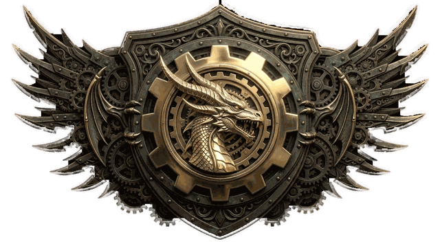

  

<h1 align="center">WildsCompanion</h1>

  Begleit-Mod für <b>Monster Hunter Wilds</b> (PC / Steam, REFramework) - ein Fan-Projekt.

## Herunterladen

Die neueste Version steht unter **[Releases](https://github.com/DontKonw234/wildscompanion-releases/releases/latest)**.

- **Neu hier?** Lade `WildsCompanion-<Version>.zip` herunter, entpacke es und starte `WildsCompanion.exe`.
  Der Launcher richtet den Mod im Spielordner ein; alles Weitere steht in `LIESMICH.txt` im Zip.
- **Du hast den Launcher schon?** Dann musst du nichts tun: Er holt Updates beim nächsten Start von selbst.
  Die anderen Dateien eines Releases (`wildscompanion-update.json`, `...-mod.zip`, `...-Launcher-....exe`) sind für den Launcher gedacht.

Alle Dateien sind signiert; der Launcher installiert nur, was die Signatur des Autors trägt.

## Was ist das?

Ein Mod mit einzeln schaltbaren Modulen: Schadensanzeige, Monster-Infos, Build-Hilfen, Jagd-Protokoll und mehr.
Er liest nur und verändert keine Spielwerte. Bei gewerteten Quests (Online-Rangliste) pausiert er sich selbst.
Der Mod selbst macht keinen Netzwerkzugriff; nur der Launcher fragt diese Seite nach Updates.

## Hinweis

Dieses Repository enthält nur Veröffentlichungen, keinen Quelltext. Privates Fan-Projekt ohne Verbindung zu Capcom.
„Monster Hunter Wilds“ ist eine Marke von CAPCOM CO., LTD. Das Wappen und das Symbol sind eigene Werke des Projektautors.
